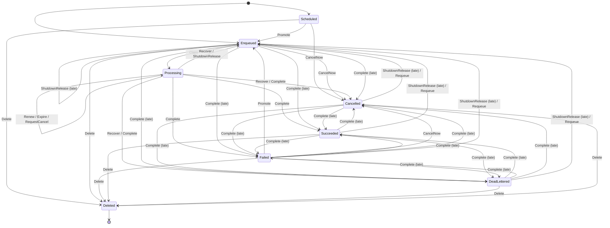

# F1 Job lifecycle and leases

Covers: a job moving through claim, lease renewal and expiry, completion, retry, recovery, cancel, requeue, delete and shutdown release, with two nodes working at once.

## Rules

- SingleLeaseHolder (always): At most one node holds a job's current lease token. REQ-001
- AttemptsWithinMax (always): A job's attempt count stays between zero and the maximum number of attempts. REQ-008, REQ-013
- CancelledNeverAwaitsRetry (always): A job whose cancel was requested is never Failed waiting for a retry. REQ-006
- StaleTokenChangesNothing (each step): A renewal or completion sent with a token that is no longer the job's current one leaves the job as it was. REQ-002, REQ-003
- RepeatChangesNothing (each step): Sending the same completion again after a lost answer leaves the job as it was. REQ-004
- CancelRequestHonoured (each step): Once a cancel has been requested for a running job, the job never goes back to Enqueued, Scheduled or Failed unless an operator requeues it. REQ-006, REQ-008, REQ-009
- RequeueOnlyFromEndStates (each step): A requeue happens only from DeadLettered, Failed, Cancelled or Succeeded, puts the job in Enqueued and resets its attempts to zero. REQ-010
- NoDeleteWhileProcessing (each step): A Processing job is never deleted. REQ-011
- ReleaseDoesNotCountAttempt (each step): A job released at shutdown goes back to the attempt count it had before that run was claimed. REQ-012
- FinalStaysFinal (each step): A Succeeded, DeadLettered or Cancelled job stays so unless an operator requeues or deletes it. REQ-005, REQ-009

## Assumptions

- Time is not modelled: a lease may expire at any moment while the job is Processing, and a Failed or Scheduled job may become due at any moment. REQ-007, REQ-008
- A job is claimed at most three times in total, so lease tokens are bounded. REQ-001
- An operator requeues a job at most once. REQ-010
- A job's lease token changes only when the job is claimed again; nothing in the requirements retires it on recovery, release, requeue or completion, and the store checks only the token. REQ-002, REQ-003, REQ-008
- A node knows its lease is lost only when a renewal is refused; until then it keeps running the job. REQ-002, REQ-003
- A node reports the Cancelled outcome only after a renewal has told it a cancel was requested. REQ-009
- Cancelling a Failed job waiting for its retry counts as cancelling a job that has not started, so it is cancelled at once. REQ-009
- When an expired lease has a cancel request, recovery cancels the job whatever its attempts. REQ-008
- A requeue clears an earlier cancel request; nothing else does. REQ-009, REQ-010
- A shutdown release is checked by token like renewal and completion, the store does not check the job's state, and "not counted" means the attempt count goes down by one. REQ-012
- A node repeats a completion at most once, after which it has its answer and forgets the job. REQ-004
- A deleted job no longer exists, so nothing a node sends for it changes anything. REQ-011
- The check runs one job, since two exceed the checkable size; jobs do not interact in this feature, and a shutdown releases each job the node runs in the same way. REQ-012

## Lifecycle

Drawn from the module. The arrows marked "late" are steps the old lease holder can still take after its job was recovered, because its token stays current until the next claim. RepeatComplete uses the same store step as Complete; in the check it never changed a job.

