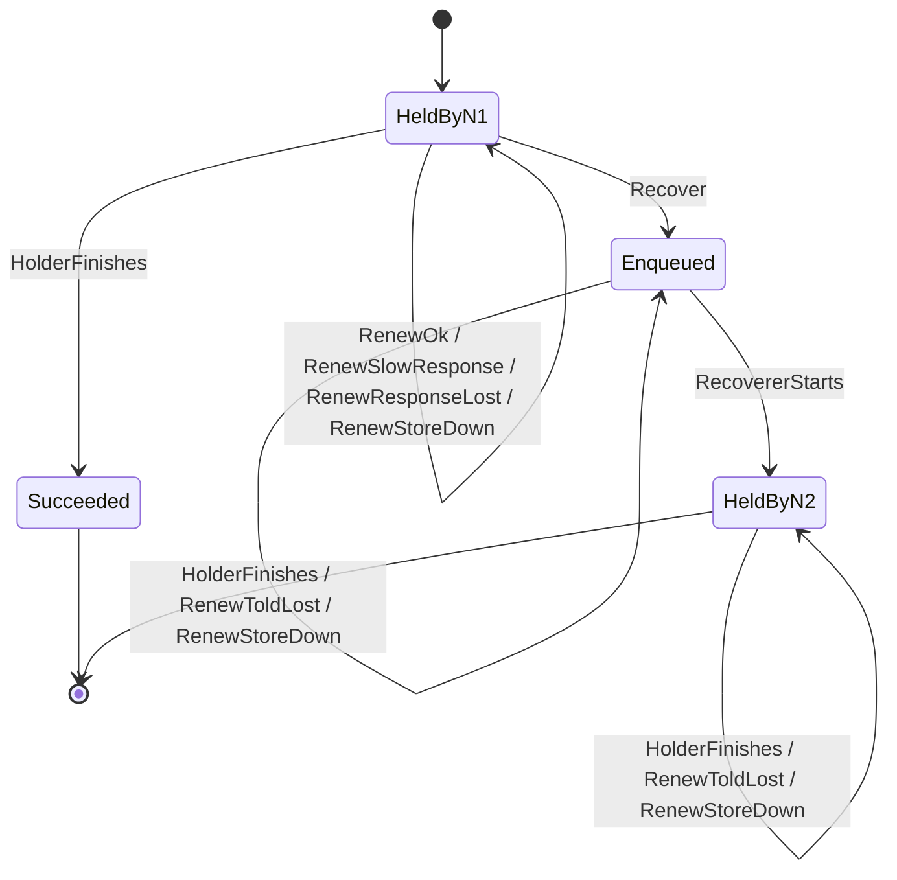
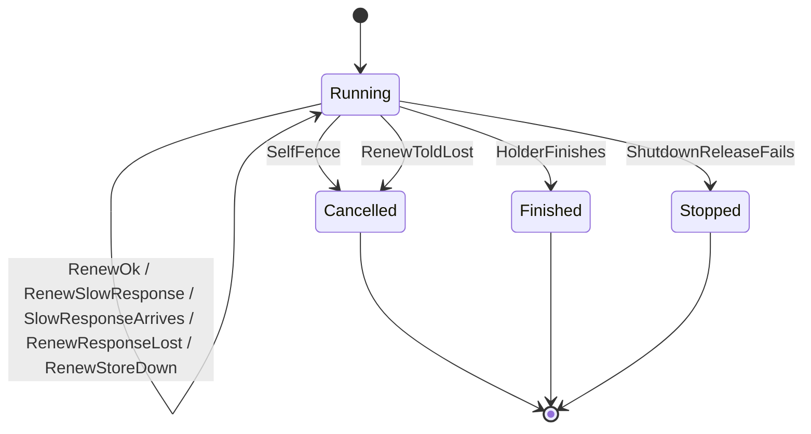

# F2 Lease heartbeat and self-fencing

Covers: node n1 runs one job and renews its lease once a tick (a third of a 3-tick lease). Renewals can succeed, get a late answer, lose their answer, or fail because the store is down. n1 cancels its handler when renewals have failed for longer than the lease since its last success. Node n2 may recover the job once the store's time is past the lease expiry, then run it. n1 may also finish on its own, or shut down with a failed lease release.

## Rules

- NoDoubleRun (always): n2 never runs the job while n1 is still running it and hasn't cancelled. REQ-015
- HealthyNeverRecovered (always): While every renewal has succeeded and its answer came straight back, no other node recovers the job. REQ-014
- CancelledByRecoveryMoment (each step): The clock never moves past a moment at which another node could recover the job (or already has) while n1's handler is still running and not cancelled. REQ-015
- RecoveredAfterFailedRelease (eventually): When n1 shuts down and releasing its lease fails, the job is recovered once the lease runs out. REQ-016

## Assumptions

- Time moves in whole ticks of a third of the lease (lease = 3 ticks), and the node tries one renewal per tick. The requirements don't say how "a third" rounds for a lease not divisible by three. REQ-014
- Both nodes' clocks equal the store's clock; clock skew is out of scope. REQ-015
- The node takes the time of a successful renewal as the moment the answer reaches it, not the moment it sent the request. REQ-015
- The claim at time 0 counts as the first successful renewal: the store's lease expires at 0 + lease length and the node counts from 0. REQ-014, REQ-015
- The node has at most one renewal waiting for an answer; a late answer arrives exactly one tick after it was sent, and the node then makes that tick's attempt. REQ-014
- The node checks whether to cancel at least once per tick, so it cancels within the first tick in which renewals have failed for longer than the lease. REQ-015
- A job recovered from n1 has attempts left, so it goes back to Enqueued, and n2 is the node that claims it. REQ-008, REQ-001
- n2 never renews its own lease and nothing recovers the job from n2; one hand-over is modelled. REQ-014
- Only a shutdown whose lease release fails is modelled, and only early enough that the lease can run out before the clock bound (tick 8). REQ-012, REQ-016

## Lifecycle

The job, as the store sees it:

n1's handler:

