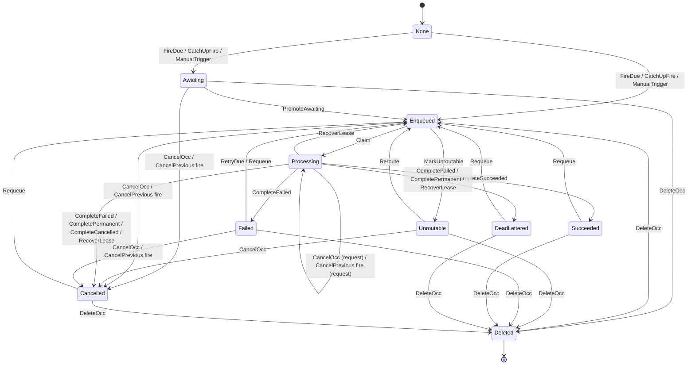

# F3 Recurring firing and overlap

Covers: one recurring definition whose due instants are fired by two nodes, plus manual triggers and catch-up fires, with its overlap policy (Skip, Queue, Allow or CancelPrevious, picked once at the start) deciding what each fire creates while earlier occurrences are still active. Occurrences are jobs, so the job rules from F1 (REQ-005, REQ-006, REQ-007, REQ-008, REQ-009, REQ-010, REQ-011, REQ-013) and the routing rules from F5 (REQ-036, REQ-037) act on them too. Also REQ-043 from F7.

## Rules

- NoOverlap (always): Unless the policy is Allow, two occurrences of the definition are never running at the same time. REQ-021, REQ-024
- OneFirePerInstant (always): Each due instant is fired successfully by at most one node. REQ-018
- MissedReportedOnce (always): Missed occurrences of an instant are reported by at most one node, and only by the node whose fire of that instant succeeded. REQ-043
- AwaitingRunsInOrder (always): Unless the policy is Allow, a newer occurrence is never queued to run or running while an older one is still waiting its turn. REQ-021, REQ-025
- SkipCreatesNothingWhileActive (each step): Under Skip, nothing creates an occurrence while another occurrence is active. REQ-020, REQ-026
- PausedNeverFires (each step): While the definition is paused, nothing creates an occurrence of it. REQ-017
- AwaitingNeverStranded (eventually): Every occurrence that is waiting its turn is eventually queued to run, finished, or deleted. REQ-022

Steps the check assumes keep happening (weak fairness): the tick promoting the oldest waiting occurrence (REQ-022, "the next tick promotes it"), the tick moving a due Failed occurrence back to Enqueued (REQ-007, the tick runs every poll interval), a node claiming an Enqueued occurrence, and a running occurrence finishing (running jobs end). Nothing else is forced: pausing, cancelling, deleting, requeueing, cleanup and lease recovery may happen or not.

## Assumptions

- The overlap policy is fixed for the whole run; the start picks it, so one run covers all four. REQ-020, REQ-021, REQ-023, REQ-024
- At most three occurrences ever exist and at most two due instants come round; a fire that would exceed the cap is not taken. REQ-018, REQ-025
- A fire for a definition paused after it was returned as due leaves the next run time where it was. REQ-017
- A manual trigger is not refused while the definition is paused: REQ-017 only covers due fires, and REQ-026 says a manual trigger fires whatever the next run time says. REQ-017, REQ-026
- Resuming and orphaning are not modelled (F4); once paused the definition stays paused. REQ-017, REQ-032
- CancelPrevious cancels every active occurrence, and when none is active it creates the new one as Enqueued. REQ-024
- A catch-up fire creates exactly two occurrences (RunAll with a limit of two); the catch-up mode itself is not modelled. REQ-025, REQ-042
- A Skip fire's "Skipped" record is not modelled; no rule reads it. REQ-020
- "A job that hasn't started" is every status that is neither Processing nor final, including Failed and Unroutable. REQ-009
- Lease recovery checks the cancel request first, then the attempt count. REQ-008
- A lease may expire at any moment; per D-1 the old handler has stopped before recovery, so recovery never leaves two runs of one occurrence. REQ-008, REQ-015
- Every node can handle the occurrence's name except at the moment cleanup marks it Unroutable; which node claims is not modelled. REQ-035, REQ-036, REQ-037
- Requeue resets the attempt count only; the cancel request stays. REQ-010
- A deleted occurrence counts as no longer waiting for the stranding rule. REQ-011, REQ-022

## Lifecycle

Lifecycle of one occurrence, drawn from the module. `None` means not yet created. `Scheduled` is never reached: no action creates an occurrence in it.

