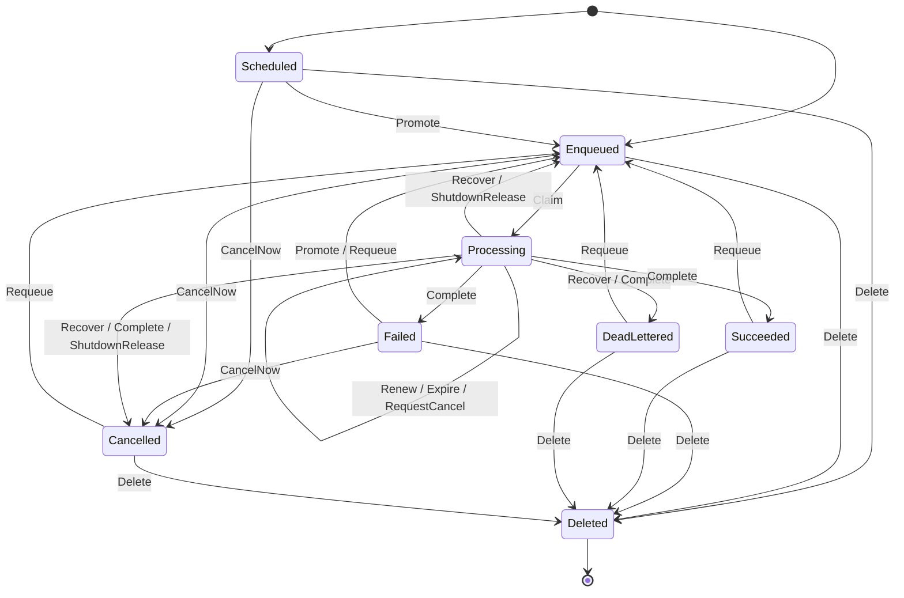

# F1 Job lifecycle and leases

Covers: a job moving through claim, lease renewal and expiry, completion, retry, recovery, cancel, requeue, delete and shutdown release, with two nodes working at once.

## Rules

- SingleLeaseHolder (always): At most one node holds a job's current lease token. REQ-001
- AttemptsWithinMax (always): A job's attempt count stays between zero and the maximum number of attempts. REQ-008, REQ-013
- CancelledNeverAwaitsRetry (always): A job whose cancel was requested is never Failed waiting for a retry. REQ-006
- StaleTokenChangesNothing (each step): A renewal, completion or shutdown release sent with a token that is no longer current, because the job was claimed again or recovered since, leaves the job as it was. REQ-002, REQ-003
- RepeatChangesNothing (each step): Sending the same completion again after a lost answer leaves the job as it was. REQ-004
- CancelRequestHonoured (each step): Once a cancel has been requested for a running job, the job never goes back to Enqueued, Scheduled or Failed, not even at shutdown, unless an operator requeues it. REQ-006, REQ-008, REQ-009, REQ-012
- RequeueOnlyFromEndStates (each step): A requeue happens only from DeadLettered, Failed, Cancelled or Succeeded, puts the job in Enqueued and resets its attempts to zero. REQ-010
- NoDeleteWhileProcessing (each step): A Processing job is never deleted. REQ-011
- ReleaseDoesNotCountAttempt (each step): A job a node gives up at shutdown, whether released to the queue or cancelled, goes back to the attempt count it had before that run was claimed. REQ-012
- FinalStaysFinal (each step): A Succeeded, DeadLettered or Cancelled job stays so unless an operator requeues or deletes it, even if the node that lost it reports late. REQ-003, REQ-005, REQ-009

## Assumptions

- Time is not modelled: a lease may expire at any moment while the job is Processing, and a Failed or Scheduled job may become due at any moment. REQ-007, REQ-008
- A job is claimed at most three times in total, so lease tokens are bounded. REQ-001
- An operator requeues a job at most once. REQ-010
- A job's lease token stays current until the job is claimed again or recovered (D-6); release, requeue and completion do not retire it, and a repeated completion is told apart by the token and outcome it carries. REQ-002, REQ-003, REQ-004, REQ-008
- A node learns its lease is lost when a renewal is refused, or when its check before writing a result or release finds the job recovered or claimed again (D-6); until then it keeps running the job. REQ-002, REQ-003
- A node reports the Cancelled outcome only after a renewal has told it a cancel was requested. REQ-009
- Cancelling a Failed job waiting for its retry counts as cancelling a job that has not started, so it is cancelled at once. REQ-009
- When an expired lease has a cancel request, recovery cancels the job whatever its attempts. REQ-008
- A requeue clears an earlier cancel request; nothing else does. REQ-009, REQ-010
- On a shutdown release the store checks the token, not the job's state, and "not counted" means the attempt count goes down by one. REQ-012
- A job cancelled at shutdown instead of released (D-5) does not have that attempt counted either, since the shutdown cut the run short. REQ-012
- A node repeats a completion at most once, after which it has its answer and forgets the job. REQ-004
- A deleted job no longer exists, so nothing a node sends for it changes anything. REQ-011
- The check runs one job, since two exceed the checkable size; jobs do not interact in this feature, and a shutdown releases each job the node runs in the same way. REQ-012

## Lifecycle

Drawn from the module. A renewal, completion or release sent by a node that no longer holds the job (it was recovered or claimed again) leaves the status as it is, and the node stops its handler; those steps change no status and are not drawn. RepeatComplete uses the same store step as Complete; in the check it never changed a job. A separate run confirmed that no status change outside these arrows can happen.

