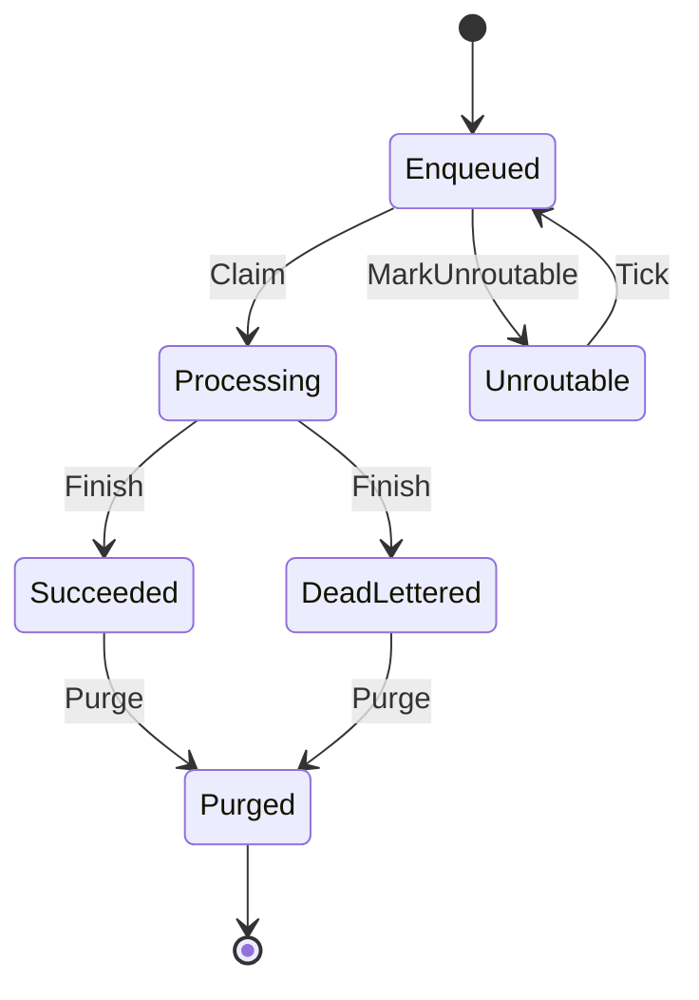

# F5 Job routing

Covers: nodes only take jobs they have a handler for, cleanup marks old waiting jobs that no live node can handle as Unroutable, a tick from a node that can handle them puts them back in the queue, and cleanup only deletes finished jobs. Two jobs named x; node n1 has a handler for x, node n2 does not; either node can stop and start; a node is live while its last heartbeat is no older than the node timeout (2 time steps here). A node that hasn't ticked for longer than that counts as gone, even while it still runs and even if it ticks again later (D-12).

## Rules

- NeverClaimedWithoutHandler (always): A job is only ever taken by a node that has a handler for its name. REQ-035
- UnroutableOnlyWithoutLiveHandler (each step): A job is marked Unroutable only at a moment when no live node can handle it. REQ-036
- YoungJobLeftAlone (each step): A job younger than the routing grace period is never marked Unroutable. REQ-036
- UnfinishedNeverPurged (each step): Cleanup only deletes a job that has finished. REQ-038
- HandledEventually (eventually): If a node that can handle x keeps running and keeps ticking within the node timeout, every job named x is taken by a node sooner or later. REQ-035, REQ-036, REQ-037

Only the running handler node's tick and its taking of a job are assumed to keep happening (weak fairness on `Tick(n)` and `Claim(n, j)` for n in Handlers). Time passing, cleanup, crashes and restarts may happen or not.

"Keeps ticking within the node timeout" is a premise of HandledEventually, not a limit on the model: the rule only speaks about runs in which, from some moment on, the handler node is running and its heartbeat is never older than the node timeout. Time may still pass faster than the node ticks, so the model still lets a running node go silent, be treated as gone and have its jobs marked Unroutable, which D-12 accepts. Limiting time instead would have hidden those runs from the other three rules as well.

## Assumptions

- All jobs share the one name x; Handlers are the nodes with a handler for x, and a node's handlers never change across restarts. REQ-035
- A node advertises exactly the names it has handlers for, in every heartbeat. REQ-036
- Time is counted in whole steps; a heartbeat older than the node timeout is shown as timeout + 1. REQ-036
- The routing grace period has no stated relation to the node timeout, so a job turns old at any moment, independently of heartbeats. REQ-036
- Rerouting does not reset a job's age; the requirements do not say. REQ-037
- Cleanup runs on a node that is running and live, and marks or purges one job per step, each judged on the store as it is at that moment. REQ-036, REQ-038
- Retention periods are left out; any finished job may be purged. REQ-038
- Attempts, leases and recovery of a crashed node's running job are left out (feature F1); a job running on a crashed node stays Processing. REQ-035
- A node starting again keeps its old heartbeat age until its first tick. REQ-036

## Lifecycle

