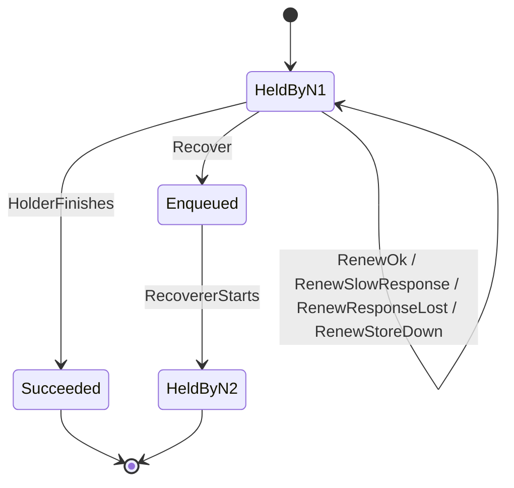
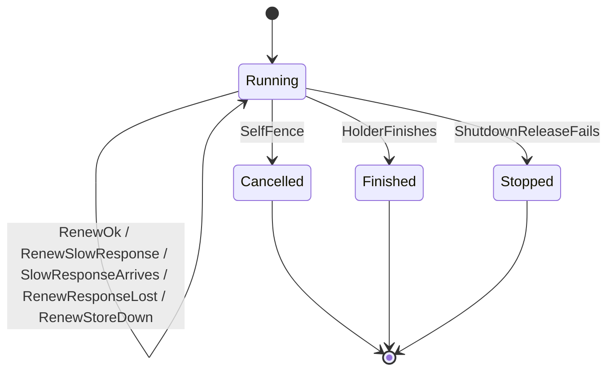

# F2 Lease heartbeat and self-fencing

Covers: node n1 runs one job under a 6-tick lease and tries to renew it every 2 ticks (a third of the lease). A renewal can succeed, get a late answer (1 or 2 ticks later), lose its answer, or fail because the store is down. n1 arms a deadline at the moment it sent its last renewal that succeeded plus 4 ticks (two thirds of the lease), and cancels its handler when the deadline passes; clock skew and pauses can delay the cancel by up to 1 tick. Node n2 may recover the job once the store's time is past the lease expiry, then run it. n1 may also finish on its own, or shut down with a failed lease release.

## Rules

- NoDoubleRun (always): n2 never runs the job while n1 is still running it and hasn't cancelled. REQ-015
- HealthyNeverRecovered (always): While every renewal has succeeded and its answer came straight back, no other node recovers the job. REQ-014
- CancelledByRecoveryMoment (each step): The clock never moves past a moment at which another node could recover the job (or already has) while n1's handler is still running and not cancelled. REQ-015
- RecoveredAfterFailedRelease (eventually): When n1 shuts down and releasing its lease fails, the job is recovered once the lease runs out. REQ-016

## Assumptions

- Time moves in whole ticks of a sixth of the lease (lease = 6 ticks); the node tries one renewal every 2 ticks (a third of the lease), and two thirds of the lease is 4 ticks. The requirements don't say how "a third" rounds for a lease not divisible by three. REQ-014, REQ-015
- Clock skew between the node and the store, plus any pause of the node, delays its cancel by at most 1 tick (a sixth of the lease, 10 s with the default 60 s lease). REQ-015 allows under a third: a separate run with 2 ticks of delay also held, and one with 3 ticks broke NoDoubleRun. REQ-015
- The node takes the time of a successful renewal as the moment it sent the request, and the store extends the lease from no earlier than that moment (D-7). REQ-015
- The claim at time 0 counts as the first successful renewal: the store's lease expires at 0 + lease length and the node counts from 0. REQ-014, REQ-015
- The node has at most one renewal waiting for an answer; a late answer arrives 1 or 2 ticks after it was sent (at most one renewal interval late, confirmed, D-14), before the next attempt. REQ-014
- The node arms its fencing deadline at the send time of its last successful renewal plus two thirds of the lease, and re-arms it on every successful renewal (D-7, revised). REQ-015
- A handler stops the moment the node cancels it; a handler that ignores the cancel, or takes time to stop, is out of scope. REQ-015
- A job recovered from n1 has attempts left, so it goes back to Enqueued, and n2 is the node that claims it. REQ-008, REQ-001
- n2 never renews its own lease and nothing recovers the job from n2; one hand-over is modelled (confirmed, D-14). REQ-014
- Only a shutdown whose lease release fails is modelled, and only early enough that the lease can run out before the clock bound (tick 12). REQ-012, REQ-016

## Lifecycle

The job, as the store sees it:

n1's handler:

RenewToldLost (n1 renews and is told the job is no longer its own) is still in the model but never happens: n1 has always cancelled before the job can be recovered, so no step leaves Running that way, and no step of n1's happens while the job is Enqueued or held by n2.
