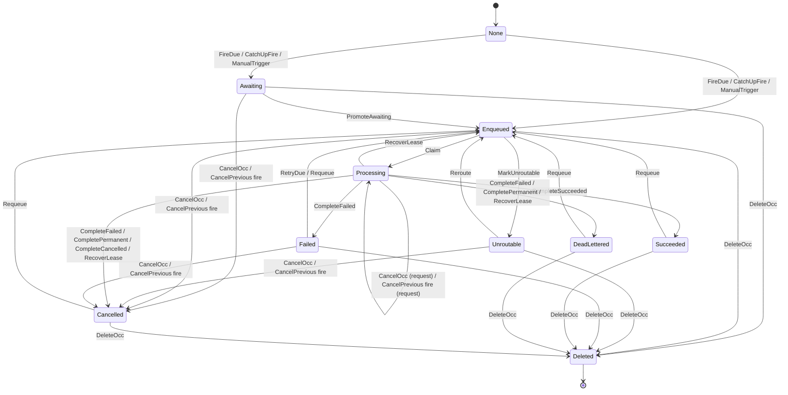

# F3 Recurring firing and overlap

Covers: one recurring definition whose due instants are fired by two nodes, plus manual triggers and catch-up fires, with its overlap policy (Skip, Queue, Allow or CancelPrevious, picked once at the start) deciding what each fire creates while earlier occurrences are still active. Occurrences are jobs, so the job rules from F1 (REQ-005, REQ-006, REQ-007, REQ-008, REQ-009, REQ-010, REQ-011, REQ-013) and the routing rules from F5 (REQ-036, REQ-037) act on them too. Also REQ-043 from F7.

Changed since iteration 1: Unroutable counts as active everywhere the model asks "is a run active" (D-3, REQ-019, through Common). A requeue ignores the overlap policy and, when another run is active, warns the operator and goes ahead (D-4, REQ-010); the warning is kept as a flag on the requeued run, and the two rules about overlap and order now allow exactly the case the owner accepted, a run requeued with a warning, and nothing else. A manual trigger works on a paused job; pausing stops only the schedule (D-11, REQ-026). The tick promotes the oldest waiting run once nothing other than waiting runs is active (REQ-021, transcription fix). A catch-up fire's sequence applies only when nothing is active; with a run active it follows the policy like any fire, so under Skip it creates nothing (REQ-025, transcription fix).

## Rules

- NoOverlap (always): Unless the policy is Allow, two runs of the job are never running at the same time, except where one of them was requeued by an operator while another run was active, which logs a warning (D-4). REQ-021, REQ-024, REQ-010
- OneFirePerInstant (always): Each due instant is fired successfully by at most one node. REQ-018
- MissedReportedOnce (always): Missed runs of an instant are reported by at most one node, and only by the node whose fire of that instant succeeded. REQ-043
- AwaitingRunsInOrder (always): Unless the policy is Allow, a newer run is never queued to run or running while an older one is still waiting its turn, except a newer run an operator requeued after being warned that another run was active. REQ-021, REQ-025, REQ-010
- SkipCreatesNothingWhileActive (each step): Under Skip, nothing creates a run while another run is active. REQ-020, REQ-026
- PausedNeverFires (each step): While the job is paused its schedule never fires: no due instant is fired, the next run time stays where it is, and only a manual trigger creates a run. REQ-017, REQ-026
- AwaitingNeverStranded (eventually): Every run that is waiting its turn is eventually queued to run, finished, or deleted. REQ-022

Steps the check assumes keep happening (weak fairness): the tick promoting the oldest waiting run (REQ-022, "the next tick promotes it"), the tick moving a due Failed run back to Enqueued (REQ-007, the tick runs every poll interval), a node claiming an Enqueued run, a running run finishing (running jobs end), and an Unroutable run being moved back once a node with the handler is live (REQ-037). Nothing else is forced: pausing, cancelling, deleting, requeueing, cleanup and lease recovery may happen or not.

## Assumptions

- The overlap policy is fixed for the whole run; the start picks it, so one run covers all four. REQ-020, REQ-021, REQ-023, REQ-024
- At most three runs ever exist and at most two due instants come round; a fire that would exceed the cap is not taken. REQ-018, REQ-025
- A fire for a job paused after it was returned as due leaves the next run time where it was. REQ-017
- Resuming and orphaning are not modelled (F4); once paused the job stays paused. REQ-017, REQ-032
- CancelPrevious cancels every active run, and when none is active it creates the new one as Enqueued. REQ-024
- A catch-up fire creates exactly two runs (RunAll with a limit of two); the catch-up mode itself is not modelled. REQ-025, REQ-042
- A Skip fire's "Skipped" record is not modelled; no rule reads it. REQ-020
- "A job that hasn't started" is every status that is neither Processing nor final, including Failed and Unroutable. REQ-009
- Lease recovery checks the cancel request first, then the attempt count. REQ-008
- A lease may expire at any moment; per D-1 the old handler has stopped before recovery, so recovery never leaves two runs of one occurrence. REQ-008, REQ-015
- Every node can handle the job's name except at the moment cleanup marks it Unroutable; which node claims is not modelled. REQ-035, REQ-036, REQ-037
- Requeue resets the attempt count and clears the cancel request, as F1 assumes (confirmed, D-13) and arch 5.3 says. Iteration 2 kept the cancel request here, which disagreed with F1. REQ-009, REQ-010
- An operator requeues at most once, and cleanup marks a run Unroutable at most once, in the whole run. This bounds the two endless loops accepted in D-4 and D-12; with them unbounded, a waiting run can wait forever, as iteration 2 showed. REQ-010, REQ-022, REQ-036
- A node with the handler eventually comes back, so an Unroutable run is eventually moved back to the queue. REQ-037
- A deleted run counts as no longer waiting for the stranding rule. REQ-011, REQ-022
- With a run active, a catch-up fire creates both its runs as Awaiting under Queue and CancelPrevious, both Enqueued under Allow, and nothing under Skip; REQ-025 now covers only a fire with nothing active. REQ-020, REQ-021, REQ-023, REQ-024, REQ-025
- The warning (a log event in M1, D-4) is a flag on the requeued run, set when another run was active at the requeue; it stays with that run and its retries until the run is no longer active or is requeued again. REQ-010

The iteration-1 assumption that a manual trigger works on a paused job is no longer an assumption: D-11 decided it, and REQ-026 now says so.

## Lifecycle

Lifecycle of one run, drawn from the module. `None` means not yet created. `Scheduled` is never reached: no action creates a run in it. Every Requeue arrow sets the warning flag when another run is active at that moment.

