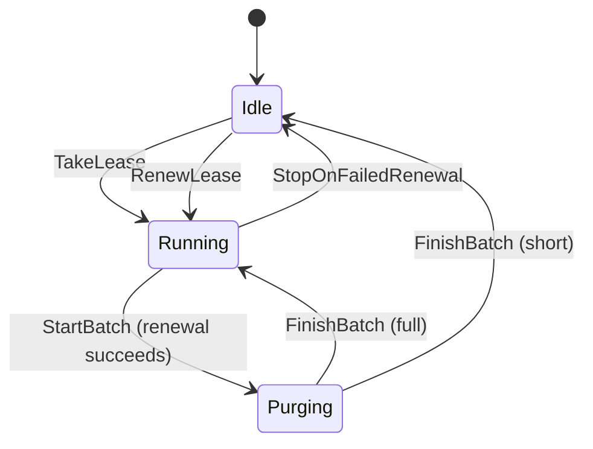

# F6 Cleanup leadership

Covers: one node at a time runs cleanup under a short lease in the store; a node takes the lease once it has expired, the holder renews it, a run renews the lease before each batch and stops when it can't, and otherwise purges in batches until a batch comes back short. "The holder can renew it" is covered by the renewal step always succeeding for the holder, not by a separate rule.

## Rules

- OneLeaseHolder (always): No two nodes hold an unexpired cleanup lease at the same moment. REQ-039
- TakeOnlyAfterExpiry (each step): A node gets the cleanup lease only when no other node holds it unexpired. REQ-039
- OnlyHolderPurges (always): A node purges a batch only while it holds an unexpired cleanup lease. REQ-040
- OneCleanupRunAtATime (always): At most one node is in the middle of a cleanup run at any moment, as the feature summary "one node at a time runs cleanup" says. REQ-039, REQ-040
- RunEndsOnShortBatch (each step): A cleanup run stops only right after a batch that came back short, or when it can't renew the lease before its next batch. REQ-041 (as changed with D-8)
- CleanupKeepsRunning (eventually): Cleanup never stops for good: some node always starts a run again. REQ-039

Steps the check assumes keep happening (weak fairness): an idle node trying to take or renew the lease, and a run going on to its next step.

## Assumptions

- The cleanup lease lasts 2 ticks; the stories give no product value. REQ-039
- An idle node may try to take or renew the lease at any tick; the cleanup interval and when each node's interval comes round are not modelled. REQ-039
- A failed attempt to start a run changes nothing; the node stays idle until it tries again. REQ-039
- A node checks the lease when it starts a run and when it renews it before each batch, never while a batch is under way. REQ-040, REQ-041
- A node runs one cleanup run at a time; while its run is in progress it touches the lease only through the renewal before each batch. REQ-040, REQ-041
- The lease is not released when a run ends; it simply expires. REQ-039
- A run has at most 3 batches, the last of which, if reached, is always short; no requirement bounds the number of full batches. REQ-041
- A batch is bounded by the store's command timeout, and the lease is at least twice that (D-8). With the pause between batches (at most 10 s), a batch and the pause after it end before the lease runs out (at most 40 s against at least 60 s), modelled as at most one of the lease's two ticks. Without this bound, OnlyHolderPurges and OneCleanupRunAtATime break, as in iteration 2. REQ-040, REQ-041
- An idle node keeps trying to take or renew the lease, and a run keeps going, so cleanup never stops for good. REQ-039
- Taking or renewing the lease is one atomic step in the store, judged by one shared store clock. REQ-039
- Nodes do not crash or stop in this model. REQ-039

## Lifecycle

A node's cleanup run, as the model allows it.

StopOnFailedRenewal is still in the model but never happens: with each batch and the pause after it bounded, a run never loses its lease before it renews, so its renewal never fails.
